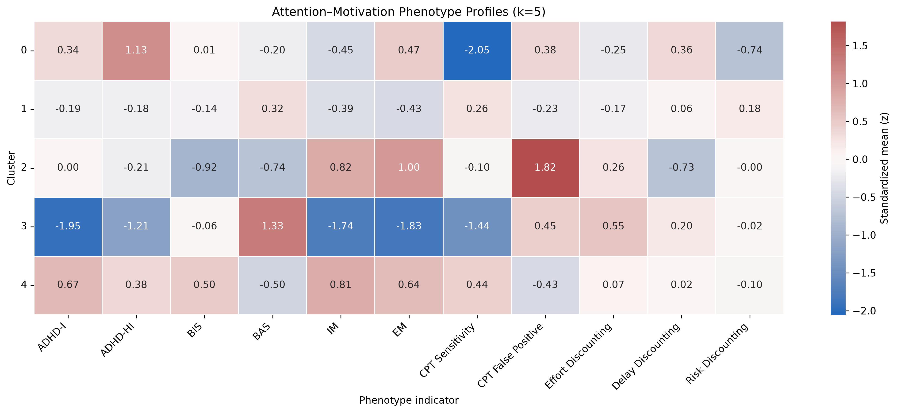
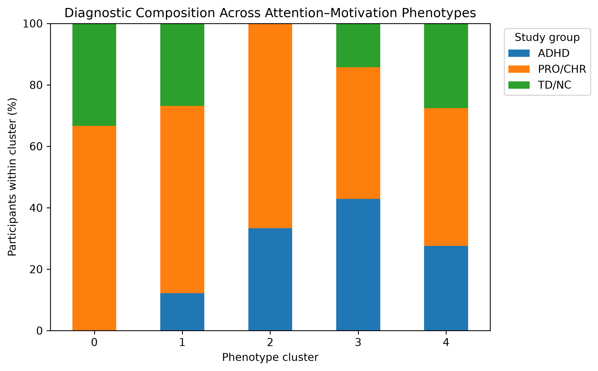
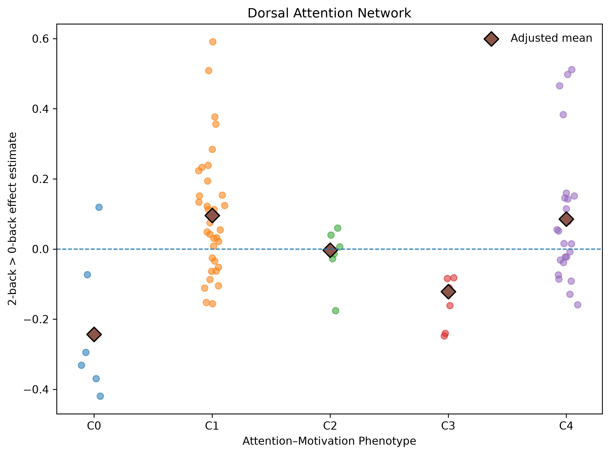
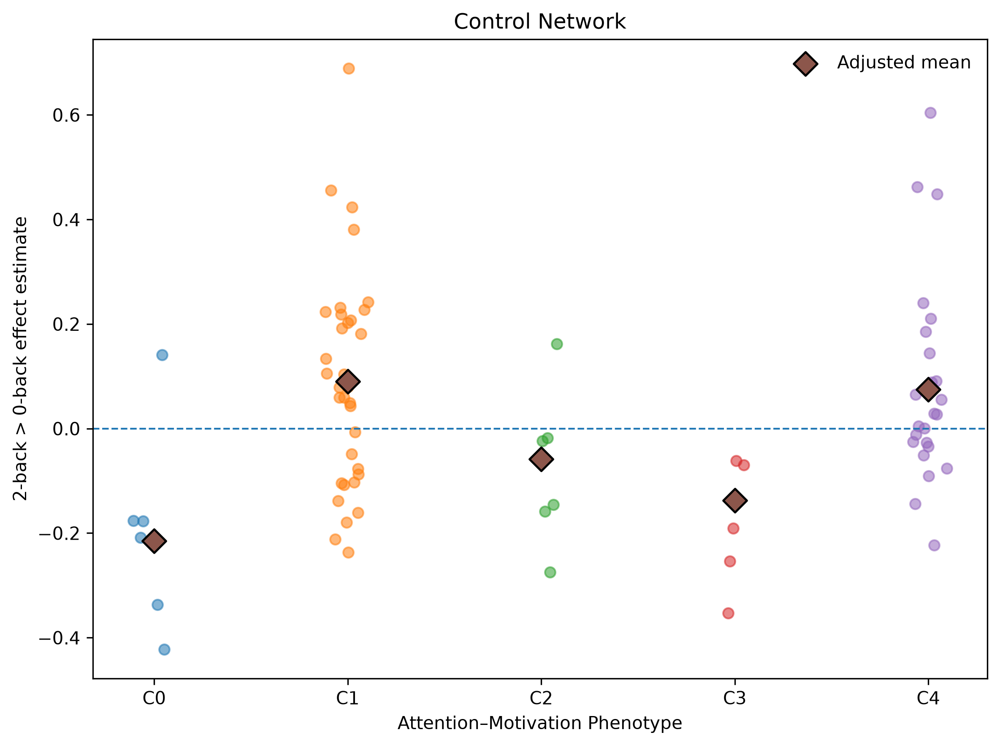
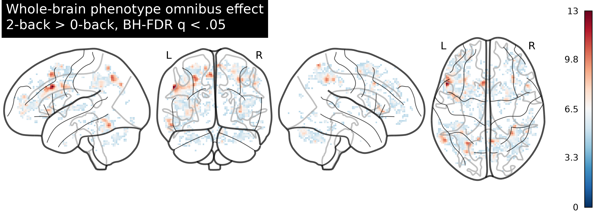
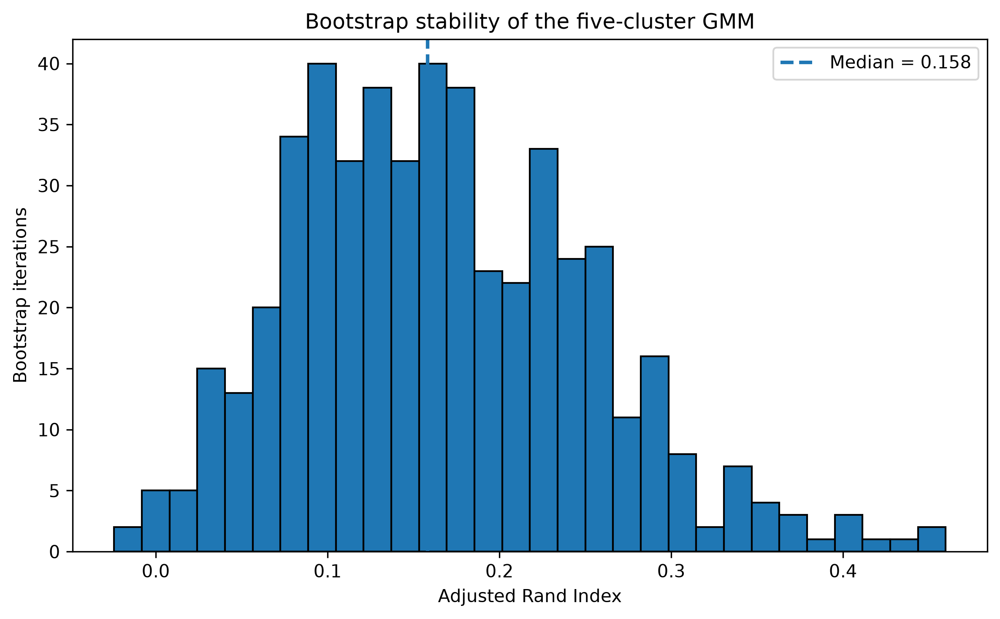

# Data-Driven Attention–Motivation Phenotypes Across Diagnostic Boundaries

A behavioral and neuroimaging analysis of the Penn Longitudinal Executive Function Dataset (Penn LEAD; OpenNeuro ds007116).

## Overview

This project examined whether heterogeneous patterns of attention and motivation could be identified across diagnostic boundaries and whether these data-driven phenotypes showed distinct clinical and neural characteristics.

Baseline self-report and behavioral measures were used to construct attention–motivation phenotypes using Gaussian mixture modeling (GMM). The resulting profiles were subsequently characterized using diagnostic and clinical variables and examined in relation to working-memory-related brain activation during an n-back task.

The project was designed as an exploratory, transdiagnostic analysis rather than an attempt to reproduce existing diagnostic categories.

## Research Questions

1. Can distinct attention–motivation profiles be identified from self-report and behavioral measures?
2. Do these profiles correspond to the original diagnostic/study groups, or do they cut across those categories?
3. Are the profiles associated with differences in clinical functioning?
4. Do the profiles differ in neural responses to working-memory load?
5. How stable is the identified phenotype solution under participant resampling?

## Dataset

**Dataset:** Penn Longitudinal Executive Function Dataset (Penn LEAD)  
**Source:** OpenNeuro ds007116  
**Participants:** 132 adolescents in the full dataset  
**Phenotype sample:** 92 participants with complete baseline data across 11 clustering indicators

Penn LEAD includes longitudinal clinical, cognitive, behavioral, and neuroimaging assessments across up to three sessions.

For phenotype construction, only baseline (`ses-1`) observations were used to maintain a cross-sectional clustering framework.

## Phenotype Features

The clustering model included 11 standardized indicators spanning attention, motivation, and behavioral performance:

- E-SWAN ADHD Inattention
- E-SWAN ADHD Hyperactivity/Impulsivity
- BIS total
- BAS total
- Intrinsic Motivation
- Extrinsic Motivation
- CPT sensitivity
- CPT false positives
- Effort discounting
- Delay discounting
- Risk discounting

## Analysis Pipeline

### 1. Data QC and Feature Processing

Phenotypic measures were merged across instruments, restricted to baseline observations, and standardized prior to clustering.

### 2. Gaussian Mixture Modeling

Full-covariance Gaussian mixture models with 2–6 components were compared using BIC, AIC, silhouette scores, subgroup size, and profile interpretability.

A five-component solution was retained as an exploratory representation. Although the six-component model showed better information criteria, it produced greater fragmentation into small components without improved cluster separation.

### 3. Phenotype Characterization

The five profiles were characterized using their standardized indicator patterns and compared with the original ADHD/proband/typically developing study-group classification.

Clinical outcomes were analyzed separately as external characterization variables.

### 4. Network-Level Neuroimaging

Working-memory-related activation was examined using the official RT-duration n-back derivatives.

The neural outcome was the subject-level **2-back > 0-back contrast**.

Cortical activation was summarized using the Schaefer-100 atlas and Yeo 7-network organization.

Phenotype effects were tested using ANCOVA models adjusting for age and sex, with FDR correction across the seven networks.

### 5. Whole-Brain Analysis

An atlas-independent voxelwise omnibus GLM tested phenotype effects on 2-back > 0-back activation while adjusting for age and sex.

The analysis included 174,794 voxels with valid estimates across all 77 participants in the primary neuroimaging sample.

Voxelwise p-values were corrected using Benjamini–Hochberg FDR.

Significant voxels were subsequently grouped into spatial components for descriptive anatomical localization.

### 6. Stability Analysis

The retained five-component GMM was evaluated using 500 bootstrap resamples.

Bootstrap-fitted models were applied to the original participants and compared with the reference partition using the adjusted Rand index (ARI).

## Main Results

### Five Exploratory Attention–Motivation Profiles

The retained GMM identified five profiles (N = 92):

| Profile | n | Descriptive pattern |
|---|---:|---|
| C0 | 6 | Higher hyperactivity / low attentional sensitivity |
| C1 | 41 | Relatively average profile |
| C2 | 9 | High intrinsic/extrinsic motivation / high CPT false positives |
| C3 | 7 | Low symptom / high BAS profile |
| C4 | 29 | Higher inattention / high intrinsic/extrinsic motivation |

The profiles reflected different configurations of symptoms, motivation, and cognitive performance rather than a simple severity continuum.



### Diagnostic Mapping

Phenotype membership was not significantly associated with the original ADHD/proband/typically developing study groups.

Permutation-based testing similarly did not support a significant association.

This indicates that the retained profiles did not simply reproduce the dataset's original diagnostic grouping.



### Clinical Characterization

Several external clinical measures differed across profiles after multiple-comparison correction, including measures of mood and anxiety-related functioning.

These analyses were treated as external characterization of the sample-derived profiles rather than evidence that the profiles represent validated clinical subtypes.

### Network-Level Neural Differences

The primary neuroimaging analysis included 77 participants.

After adjustment for age and sex and FDR correction across seven networks, phenotype effects were significant in:

- **Dorsal Attention Network**
- **Control Network**

The general profile was characterized by lower adjusted 2-back > 0-back contrast estimates in C0 and higher estimates in C1 and C4.

These effects remained significant in a sensitivity analysis restricted to participants whose subject-level neural estimates included baseline (`ses-1`) data (N = 71).





### Whole-Brain Results

Whole-brain voxelwise analysis identified **6,658 of 174,794 voxels (3.81%)** showing an omnibus phenotype effect after BH-FDR correction.

Significant effects involved frontal, parietal, temporo-occipital, insular/opercular, medial-frontal, and right cerebellar regions.

Among cortical voxels assigned to Yeo networks, significant voxels were most concentrated in:

- Dorsal Attention: 15.19%
- Control: 13.04%

The network-level and whole-brain analyses therefore showed spatially convergent patterns, although they should not be considered independent replications because they used the same participants and contrast maps.



### GMM Stability

Despite clear posterior classification within the fitted GMM, bootstrap resampling showed low stability of the overall partition.

**500-bootstrap ARI:**

- Mean = 0.166
- Median = 0.158
- 5th–95th percentile = 0.040–0.310

C1 showed the highest membership recovery, whereas the remaining profiles were substantially less stable.



This distinction is important: high posterior probabilities indicate clear classification conditional on the fitted model, whereas low bootstrap ARI indicates that the partition itself is sensitive to sampling variation.

## Interpretation

The analyses identified heterogeneous attention–motivation configurations that crossed the dataset's original study-group boundaries and were associated with differences in clinical characteristics and working-memory-related neural activation.

However, the low bootstrap stability indicates that the five-profile solution should not be interpreted as a stable or uniquely determined latent taxonomy.

The neural findings therefore characterize differences associated with this particular sample-derived partition rather than establishing replicable neurobiological subtypes.

## Repository Structure

```text
penn-lead-attention-motivation/
├── README.md
├── notebooks/
│   ├── 01_data_qc.ipynb
│   ├── 02_feature_processing.ipynb
│   ├── 03_gmm_model_selection.ipynb
│   ├── 04_phenotype_characterization.ipynb
│   ├── 05_clinical_diagnostic_analysis.ipynb
│   ├── 06_network_analysis.ipynb
│   ├── 07_wholebrain_analysis.ipynb
│   ├── 08_GMM_stability.ipynb
│   └── 09_final_summary.ipynb
├── figures/
├── results/
│   └── summary_tables/
├── derived/
└── report/
```

Raw and derivative neuroimaging data are not included in this repository.

## Methods and Reproducibility

Analyses were conducted in Python using packages including:

- pandas
- NumPy
- SciPy
- scikit-learn
- statsmodels
- nibabel
- Nilearn
- Matplotlib
- seaborn

The original dataset and required neuroimaging derivatives should be obtained from their respective OpenNeuro sources.

The notebooks preserve the analysis workflow used for this project. Dataset paths must be configured for the local environment before rerunning analyses that depend on the original Penn LEAD data or neuroimaging derivatives.

Intermediate participant-level analysis files and raw/derived neuroimaging data are not distributed with this repository.

## Scope and Limitations

This project is an exploratory secondary analysis of an existing public dataset.

Several features of the analysis limit claims about the reproducibility of the identified phenotype structure:

- The clustering sample was relatively small (N = 92).
- Several mixture components contained few participants.
- Full-covariance GMMs are highly parameterized relative to the available sample size.
- Model selection did not identify a uniquely compelling number of components.
- Bootstrap resampling showed low stability of the retained five-component partition.

In addition, the primary neuroimaging analysis used official subject-level n-back contrast estimates constructed from all available QC-eligible runs/sessions for each participant. The neural analysis should therefore not be interpreted as a strictly baseline-only fMRI comparison.

Accordingly, the profiles are treated as exploratory, sample-specific data-driven configurations rather than validated clinical subtypes. The neuroimaging findings characterize neural differences associated with the retained partition within the present sample and do not establish reproducible subtype-specific biomarkers.